# Noritsu QSF-V50 rack roller

Replacement film transport roller for the racks of the Noritsu QSF-V50 film processor. It is made of two printed parts:

- **Core (PETG):** the roller body on a Ø6 mm shaft, with end flanges and eight anti-rotation ribs.
- **Sleeve (TPU):** the rubber covering with a raised diamond grid, printed flat as a sheet and wrapped onto the core.

> **Status:** designed and checked in CAD (fits, overhangs, slicing). Not yet print-tested in the machine.

  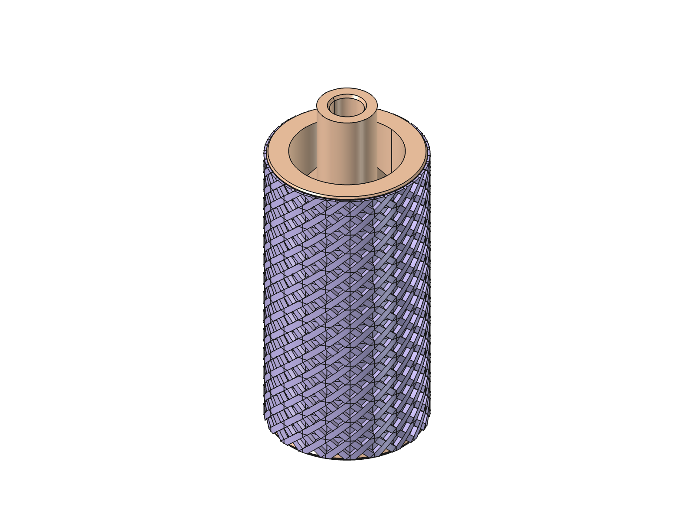
  

## Files

| File | Use |
|---|---|
| [`step/Noritsu_V50_Roller_Core_PETG.step`](step/Noritsu_V50_Roller_Core_PETG.step) | Print: PETG core |
| [`step/Noritsu_V50_Roller_Sleeve_TPU_Flat.step`](step/Noritsu_V50_Roller_Sleeve_TPU_Flat.step) | Print: TPU sleeve as a flat sheet |
| [`step/Noritsu_V50_Roller_Assembly.step`](step/Noritsu_V50_Roller_Assembly.step) | Reference: core with the fitted, textured sleeve |
| [`step/Noritsu_V50_Roller_Sleeve_TPU_Fitted.step`](step/Noritsu_V50_Roller_Sleeve_TPU_Fitted.step) | Reference: the sleeve as it sits on the core |
| [`step/Noritsu_V50_Roller_Design_Reference.step`](step/Noritsu_V50_Roller_Design_Reference.step) | Reference: the original roller geometry before print optimisation (1 mm mid-length partition, Ø6 bore) |
| [`step/Noritsu_V50_Original_Sleeve_TPU_Flat.step`](step/Noritsu_V50_Original_Sleeve_TPU_Flat.step) | Print: TPU sleeve for the original roller, flat sheet |
| [`step/Noritsu_V50_Original_Assembly.step`](step/Noritsu_V50_Original_Assembly.step) | Reference: original roller with its fitted, textured sleeve |
| [`step/Noritsu_V50_Original_Sleeve_TPU_Fitted.step`](step/Noritsu_V50_Original_Sleeve_TPU_Fitted.step) | Reference: that sleeve as it sits on the original roller |
| [`step/Noritsu_V50_Roller_Sleeve_TPU_Smooth_Flat.step`](step/Noritsu_V50_Roller_Sleeve_TPU_Smooth_Flat.step) | Print: smooth TPU sleeve (no grid), flat sheet |
| [`step/Noritsu_V50_Original_Sleeve_TPU_Smooth_Flat.step`](step/Noritsu_V50_Original_Sleeve_TPU_Smooth_Flat.step) | Print: smooth TPU sleeve for the original roller, flat sheet |
| [`step/Noritsu_V50_Roller_Smooth_Assembly.step`](step/Noritsu_V50_Roller_Smooth_Assembly.step) · [`step/Noritsu_V50_Original_Smooth_Assembly.step`](step/Noritsu_V50_Original_Smooth_Assembly.step) | Reference: both rollers with the smooth sleeve fitted |
| [`step/Noritsu_V50_Roller_Dovetail_Core_PETG.step`](step/Noritsu_V50_Roller_Dovetail_Core_PETG.step) | Print: PETG core with dovetail slot |
| [`step/Noritsu_V50_Roller_Dovetail_Sleeve_TPU_Flat.step`](step/Noritsu_V50_Roller_Dovetail_Sleeve_TPU_Flat.step) | Print: smooth TPU sleeve with dovetail ends, flat sheet |
| [`step/Noritsu_V50_Roller_Dovetail_Assembly.step`](step/Noritsu_V50_Roller_Dovetail_Assembly.step) | Reference: dovetail core with the sleeve fitted |
| [`cad/NoritsuV50_Roller.FCStd`](cad/NoritsuV50_Roller.FCStd) | Parametric FreeCAD model with all of the above |

## Main dimensions

| | |
|---|---|
| Shaft / bore | Ø6 mm shaft, Ø6.5 mm printed bore (free running) |
| Running diameter | Ø26.5 mm core, about Ø30.9 mm over the grid |
| Flanges | Ø30 mm, 0.6 mm thick, 40° cones underneath |
| Length | 60 mm between flange faces, 70.4 mm with the hub stub |
| Hub | Ø11.3 mm, 2.4 mm wall; free for 5 mm at both ends (end recesses) |
| Grip ribs | 8 × trapezoid, 1.8 mm base, 1.2 mm top, 0.6 mm high |
| Sleeve | 1.2 mm base + 1 mm raised diamond grid: ribs 1.2 mm wide (2 lines of 0.6 mm) at ±45°, 3 mm pitch, 21 cells around |

## Core (PETG)

  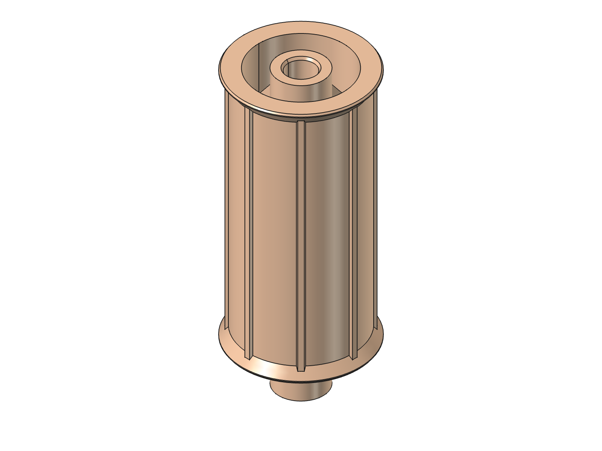
  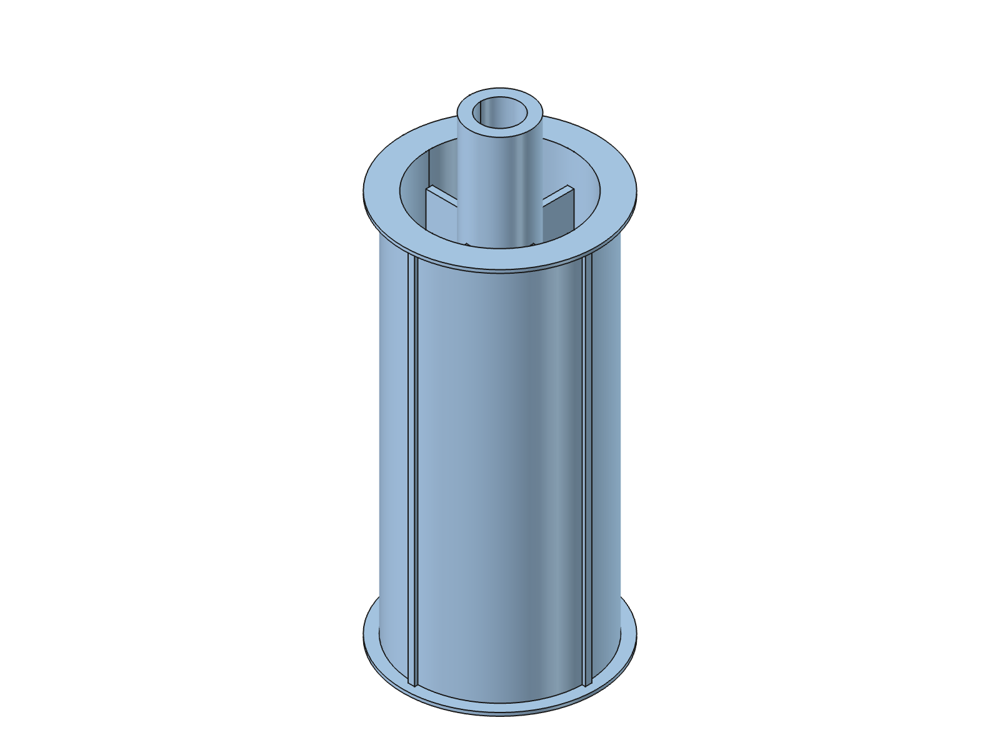

- **Orientation:** bottom end face on the bed, roller axis vertical. No supports: every overhang is 40° or less from vertical.
- **Inside:** four spokes join the hub to a 2.4 mm shell. A 2 mm web at mid-length closes the cavities; its underside is a tapered roof, so it prints without bridging. The 5 mm end recesses around the hub are the same depth at both ends.
- **Slicing (measured):** OrcaSlicer, Bambu Lab A1 0.4 nozzle, *0.20mm NordicLab 0.6 Ballance*, AzureFilm PETG HF: **1 h 25 min, 24.6 g**. The walls are all perimeters, so forcing solid walls does not change the result.

## Sleeve (TPU)

  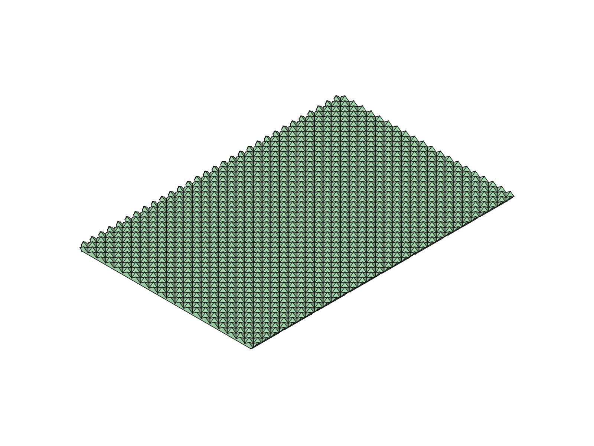
  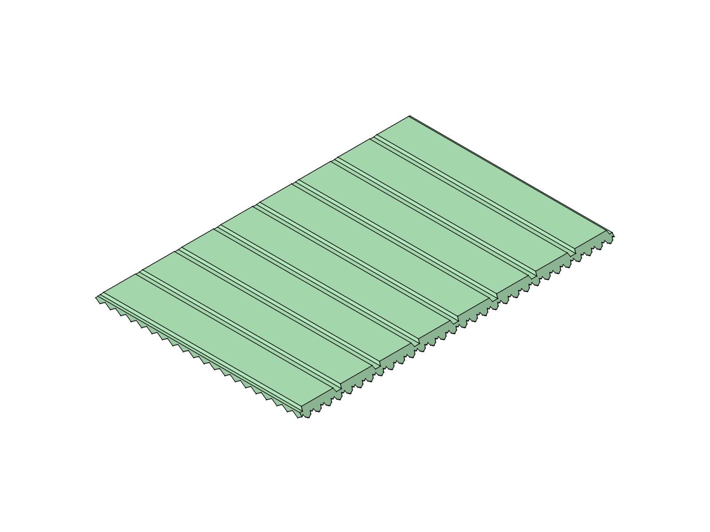

- **Print flat:** inner face on the bed, grid up. The grid ribs have vertical walls and no tips, so every layer is a continuous path: it prints cleanly with a 0.6 mm nozzle and avoids the stringing TPU gets from many small islands. The sheet is 54.0 mm wide at the inner face and 89.55 mm long: the circumference at the neutral layer of the base plus grid (r ≈ 14.25 mm), rounded to 21 whole grid cells so the pattern meets at the seam. (v1.1 was 85.28 mm, about 4 mm too short: it ignored the grid when bending.)
- **Rib grooves:** eight grooves on the underside, with a half groove at each end so the seam lands on a rib. They have 0.1 mm clearance per side; the bevelled sheet ends leave 0.2 mm to each flange cone.
- **Slicing (measured):** *0.20mm NordicLab 0.6 Slow TPU*, AzureFilm TPU: **1 h 17 min, 10.7 g** with a 0.6 mm nozzle (Bambu Lab A1 0.6 nozzle), 1 h 28 min, 10.8 g with a 0.4 mm nozzle.
- **Assembly:** wrap the sheet onto the core with the grooves over the ribs and the seam on a rib. The flange cones hold both edges.

  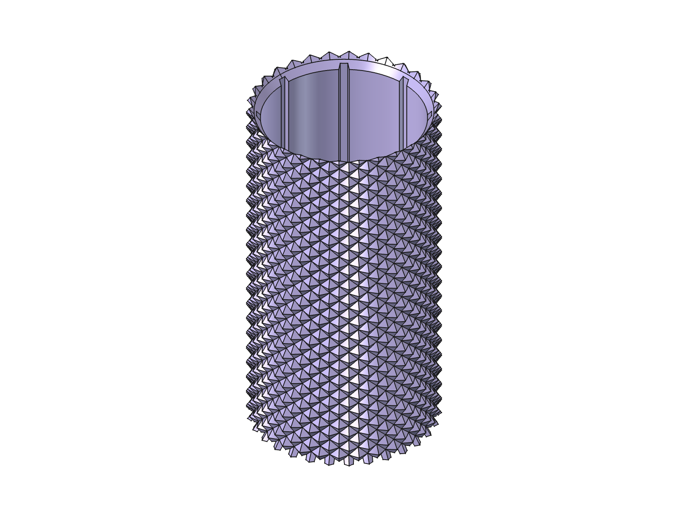
  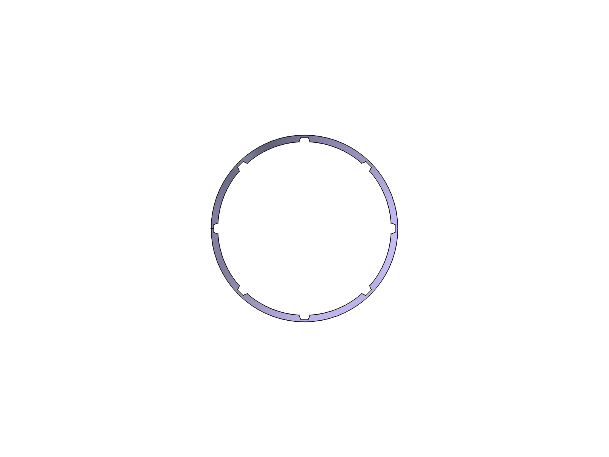

The fitted sleeve (`SleeveFitted`) is a reference model with an exact, zero-clearance fit on the core. Its grid is built from one computed tile (an 18° piece with short helical ribs), repeated 294 times as linked copies, so the reference STEP files contain 295 solids. Use the flat sheet for printing.

## Sleeve for the original roller (TPU)

The same grid-textured TPU sleeve, made for the original roller geometry (`Roller`): flat Ø30 × 0.5 mm flanges without cones, and four rectangular ribs of 1 × 0.5 mm.

  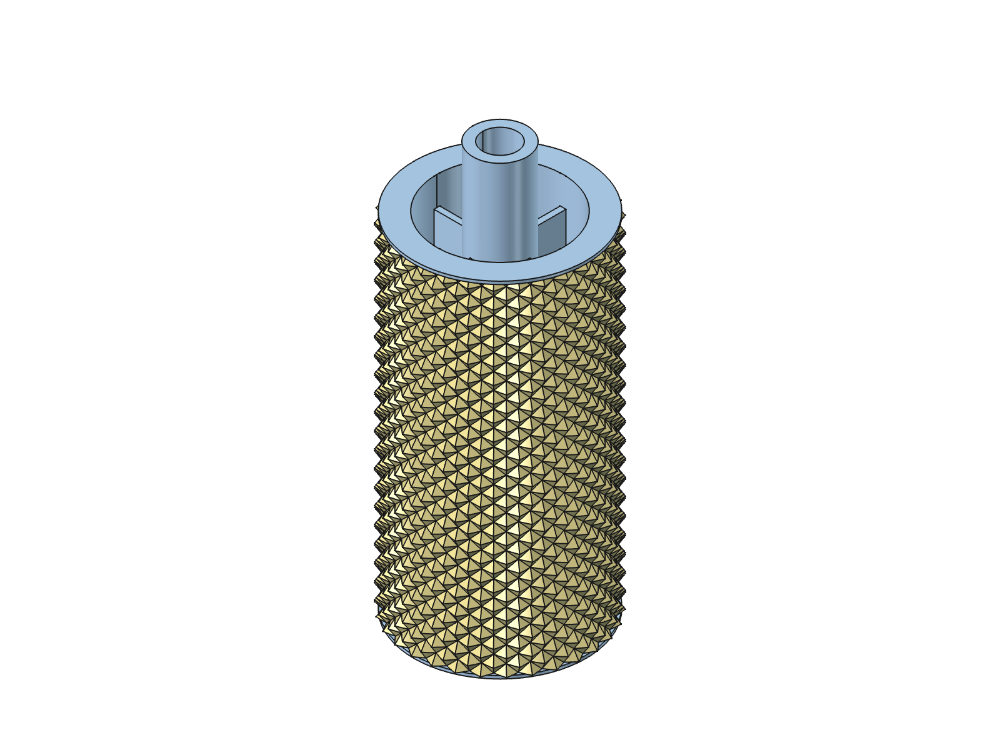
  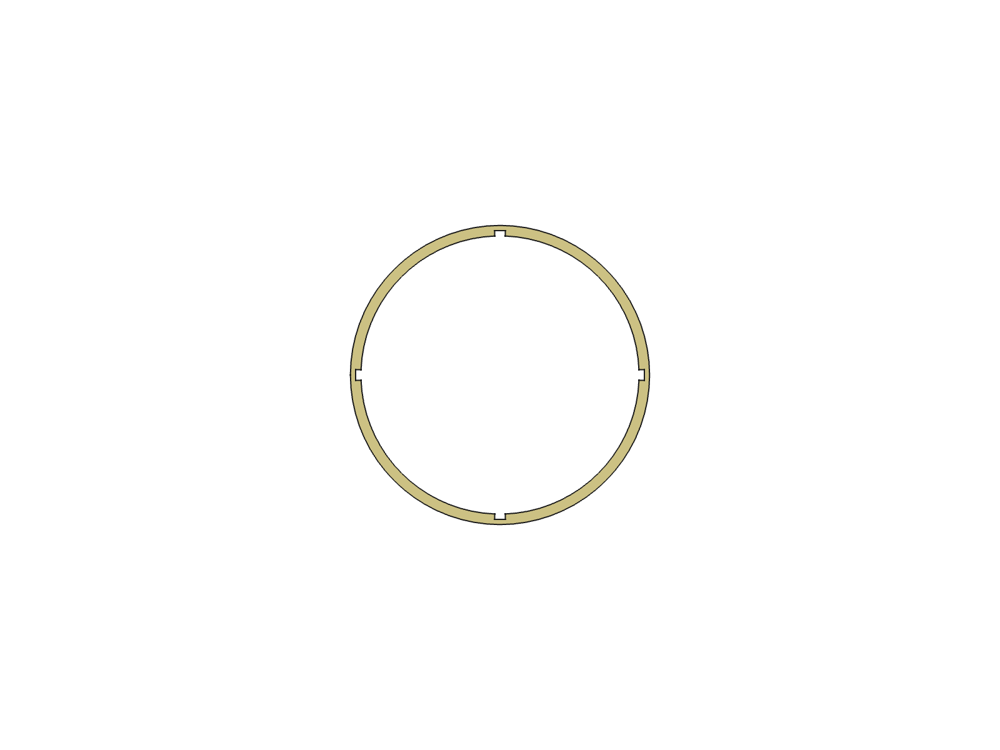

  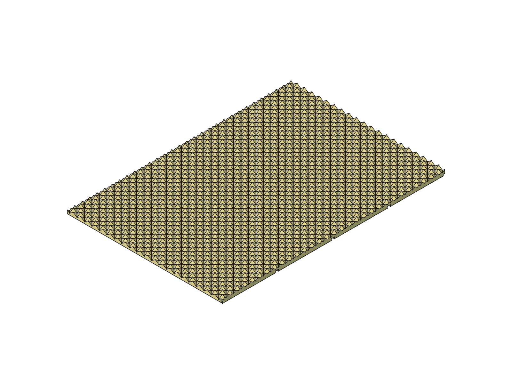
  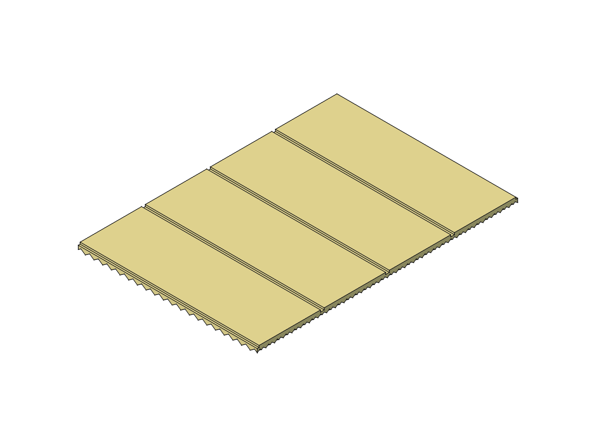

- **Print flat:** the sheet is 58.6 mm wide (59 mm between the flanges, minus 0.2 mm at each end) and 89.55 mm long, with square ends because the flanges are flat. Base 1.2 mm, grid 1 mm.
- **Rib grooves:** four rectangular grooves 1.2 × 0.6 mm (0.1 mm clearance on each side and on top), with a half groove at each end so the seam lands on a rib. 0.6 mm of rubber remains over each groove.
- **Slicing (measured):** *0.20mm NordicLab 0.6 Slow TPU*, AzureFilm TPU: **1 h 19 min, 11.8 g** with a 0.6 mm nozzle, 1 h 24 min, 11.8 g with a 0.4 mm nozzle.
- **Fitted reference (`SleeveFittedOrig`):** exact zero-clearance fit on `Roller`, checked: no overlap and no void between roller and sleeve; the grid reuses the same tile as above plus one top tile trimmed at the flange, 294 linked copies.

## Smooth sleeve (TPU)

A variant without the grid: a plain 1.6 mm TPU sleeve (8 layers) with a smooth outer surface, for both rollers. Its outer diameter is Ø29.7 mm, just inside the Ø30 mm flanges. The rib grooves, clearances and seam-on-a-rib layout are the same as on the grid sheets, with 0.9 mm (print-optimised core) or 1.0 mm (original core) of rubber over each groove.

  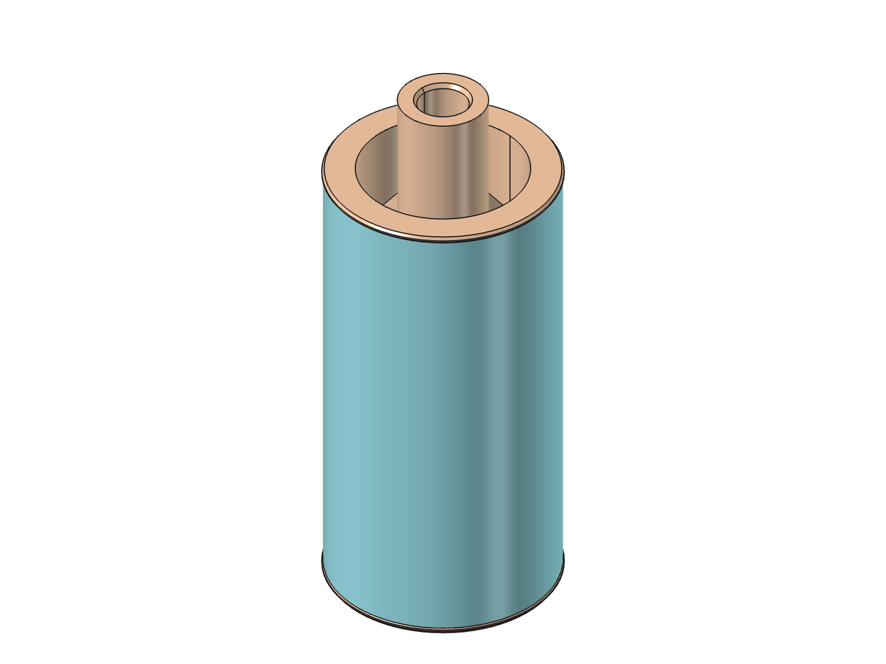
  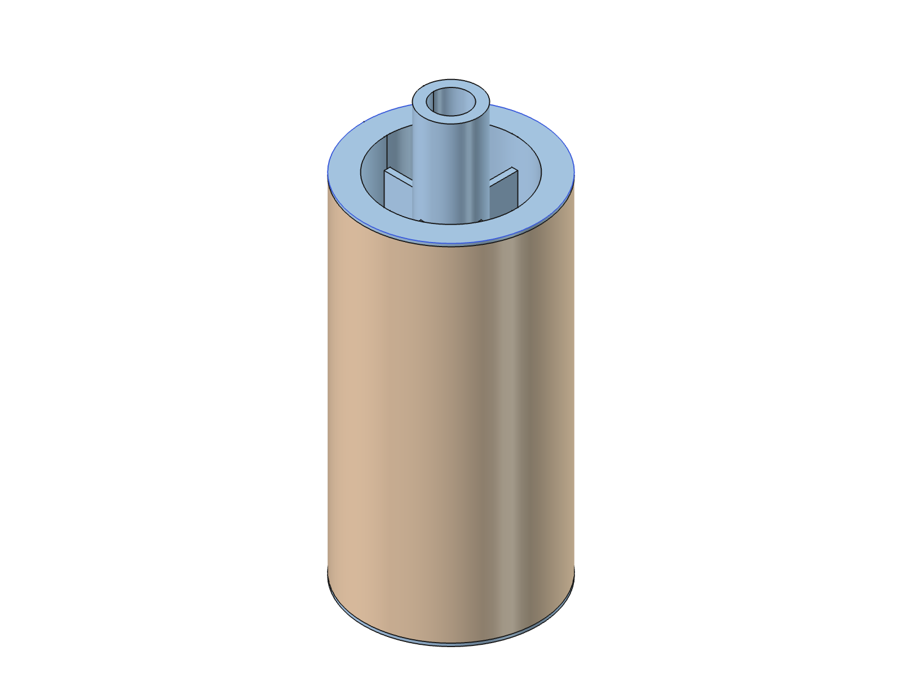

  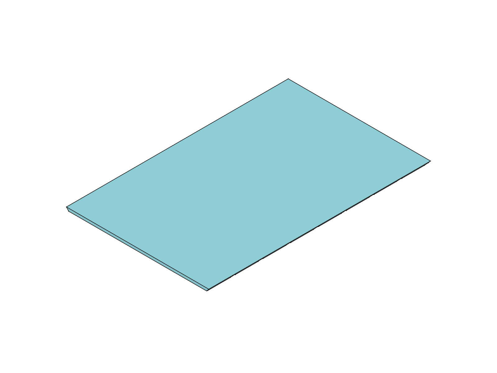
  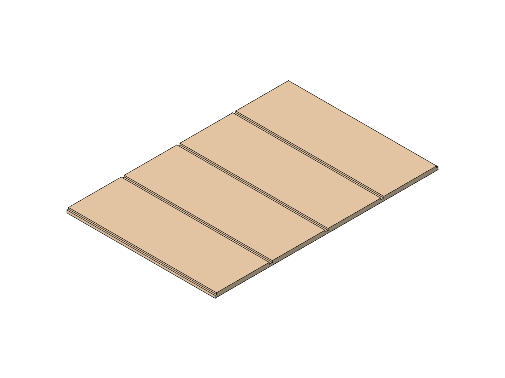

- **Length:** 88.28 mm, the circumference at the middle of the 1.6 mm sheet (r 14.05 mm), where a plain sheet neither stretches nor compresses when wrapped. No preload.
- **Width:** 54.0 mm at the inner face with 40° bevelled ends (print-optimised core), 58.6 mm with square ends (original core).
- **Slicing (measured):** Bambu Lab A1 0.6 nozzle, *0.20mm NordicLab 0.6 Slow TPU*, AzureFilm TPU: **59 min, 9.2 g** (print-optimised core) and **1 h 1 min, 10.1 g** (original core).
- **Fitted references (`SleeveFittedSmooth`, `SleeveFittedSmoothOrig`):** exact zero-clearance fit, checked: no overlap and no void between roller and sleeve.

## Dovetail version (PETG core + smooth TPU sleeve)

A separate core in which one of the eight ribs is replaced by an axial dovetail slot, and a smooth sleeve whose two ends carry half-dovetail keys. Rolled up, the two ends meet and together form a full dovetail; slid onto the core from the top, the key runs along the slot and holds the seam closed, so the ends cannot pull out.

  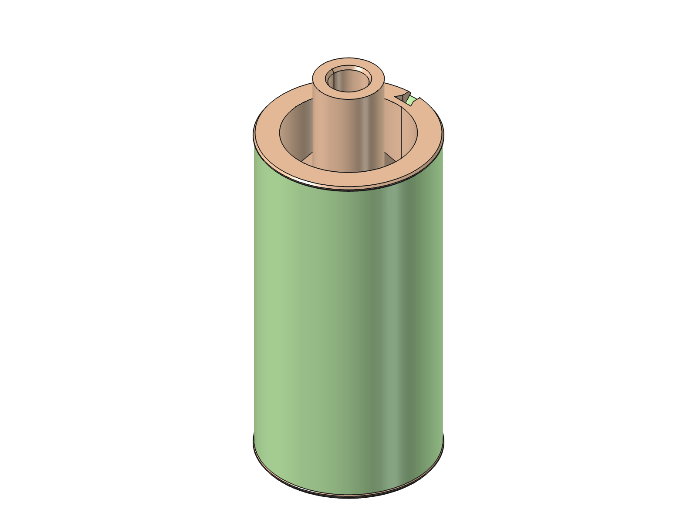
  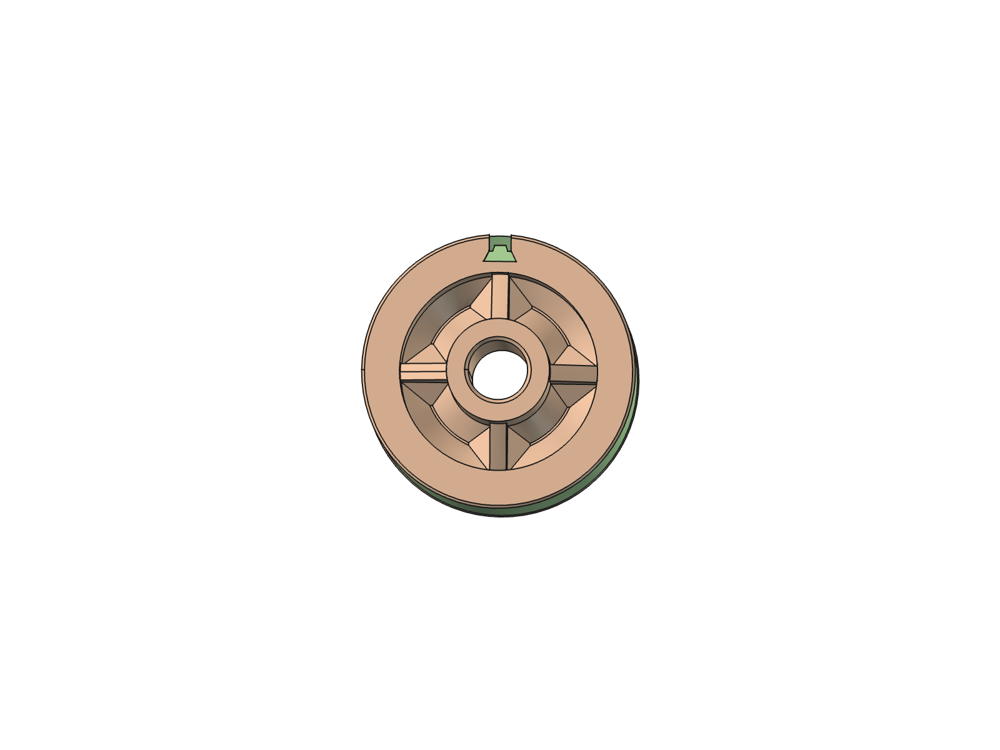

  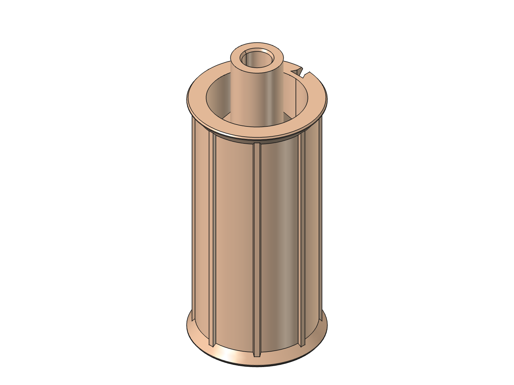
  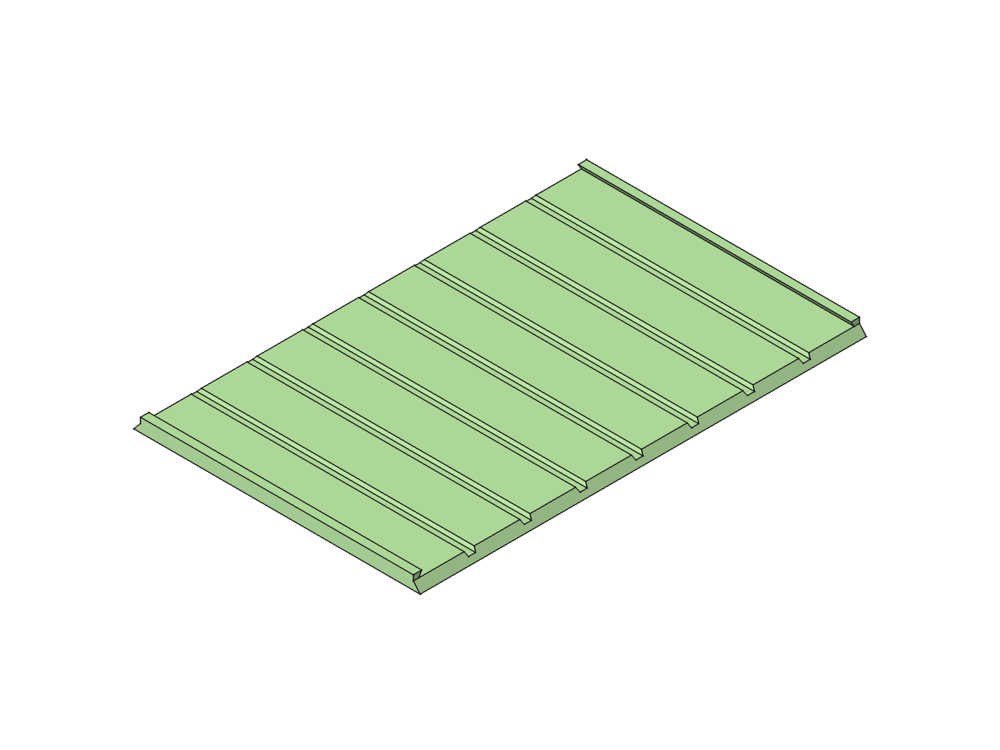

- **Slot (core):** 2.4 mm neck at the drum surface, 3.6 mm at the bottom, 1.2 mm deep, over a spoke. It is open through the top flange and closed at the bottom cone (z 2.8 mm), which works as the axial stop. Prints standing like the other core, no supports. *0.20mm NordicLab 0.6 Ballance*, PETG: **1 h 24 min, 24.3 g**.
- **Sleeve:** smooth 1.6 mm sheet, 88.28 mm long, seven rib grooves, and a half-dovetail key along each end (0.15 mm sliding clearance per side). Print it **outer face down, keys up**: the keys' slanted faces lean 30° from vertical. Bambu Lab A1 0.6 nozzle, *0.20mm NordicLab 0.6 Slow TPU*: **58 min, 9.7 g**.
- **Assembly:** roll the sheet into a tube so the two keys meet, then push the tube onto the core from the top end with the key in the slot, until it reaches the bottom stop. The sleeve has to stretch over the Ø30 mm top flange on the way.
- **Fitted reference (`SleeveFittedSmoothDovetail`):** exact zero-clearance fit on `RollerPrintDovetail`, checked: no overlap and no void, including the slot.

## Model notes

- All sizes are in the `params` spreadsheet. The print-specific values start with `p_`; the sleeve values start with `sl_`, `kn_` and `fit_`.
- `Roller` is the original design, `RollerPrint` the print-optimised core. `SleeveFlat` is the printable sheet; `SleeveFitted` and the `SleeveTexture` group are the fitted reference. `SleeveFlatOrig`, `SleeveFittedOrig` and `SleeveOrigTexture` are the same set for the original roller (params `o_…`). `SleeveFlatSmooth`, `SleeveFlatSmoothOrig`, `SleeveFittedSmooth` and `SleeveFittedSmoothOrig` are the smooth variant (params `t_smooth`, `sm_…`). `RollerPrintDovetail` (BaseFeature = `RollerPrint` + `DovetailSlot`), `SleeveFlatSmoothDovetail` and `SleeveFittedSmoothDovetail` are the dovetail version (params `dt_…`).
- A ready-to-paste shop description is in [`docs/ko-fi-description.md`](docs/ko-fi-description.md).
- The grid links are placed by a script, not by expressions. After changing `kn_n`, `kn_s`, `p_fl` or `L_roll`, regenerate them as described in [`AGENTS.md`](../AGENTS.md).
